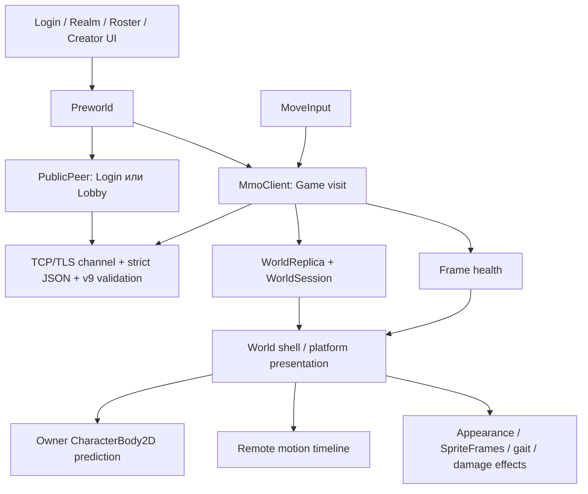

# Hello Kotone: карта клиента

Статус: **IMPLEMENTED**, текущий Godot client public v9.
[Общая карта серверного проекта](https://github.com/ronkiko/ai_research/blob/main/ARCHITECTURE.md) объясняет реальные
Login/Lobby/Game/Storage/Worker процессы; [GitHub](https://github.com/ronkiko/ai_research/blob/main/ARCHITECTURE.md).
Общие physics/wire/security contracts принадлежат серверному репозиторию.

## Сеть серии 10 — PLANNED / DRAFT

Этот Godot-клиент — часть multirepo вместе с `ronkiko/ai_research` и private
`ronkiko/go-networking`. Новый сетевой репозиторий уже создан и содержит архитектурную карту, но пока не содержит реализации;
его [README](https://github.com/ronkiko/go-networking/blob/main/README.md) —
каноническая карта GNC/GNS/GNPC. `hello-kotone` владеет только Godot native
binding, интеграцией и упаковкой GNC; реализация Go-клиента, сервера и общего
кодека сюда не копируется. MMO-авторитет остаётся в `ai_research`.

Текущая игровая сеть ещё не использует Go: ниже описан **реальный Godot public
v9**. Переход к GNC/GNS требует прохождения 10.00 и отдельного утверждения плана.
[Решение и этапы](https://github.com/ronkiko/ai_research/blob/main/v3/docs/roadmap/v3/main/10/README.md).

## Один клиентский процесс

Godot запускает Login scene. Autoload `Preworld` ведёт account/realm/Lobby visit,
`MmoClient` — выбранный Game visit. UI scenes подписываются на их сигналы;
смена сцены не переносит sockets в renderer. Отдельный GameState autoload содержит
локальные RC3 story fields; MMO не использует их как server state.

## Вход, UI и сеть

Login shell собирает endpoint/security profile и credentials. Preworld получает
Directory, проходит выбранный Lobby и загружает roster/catalog. Creator сначала
выбирает semantic model, затем model-scoped appearance; локальная поддержка
проверяется до preview, но окончательная validation и ownership принадлежат
серверу. Selection, delete, pending mutation и takeover — состояния визита,
не прямые изменения игрового тела. UI не выводит tickets, passwords и session secrets.
[Flow и Creator](godot/docs/realm-lobby.md).

PublicPeer держит один bounded request slot для Login/Lobby, correlation и
connection generation. MmoClient отдельно ведёт Game bootstrap, session rules,
request spacing/keepalive, desired-control slot и pending reply. Оба используют
native StreamPeerTCP/StreamPeerTLS, проверку сертификата в Beta, bounded frame
buffer/partial writes и deadlines. DNS разрешается асинхронно. TLS error не
переключает канал на plaintext; local dev принимает только loopback.
Strict wire JSON отсекает неоднозначные значения до v9 schema validation.
[Wire lifecycle](godot/docs/motion-wire-v8.md) (имя пути сохранено для ссылок).

При world entry MmoClient связывает identity/capabilities, проверяет snapshot,
map и world_rules. Map cache хранит только проверенный immutable content; key
хеширует полную reference. Повреждённый cache становится miss, повреждённый
network map — fault. Успешный cache hit не отменяет State readiness.
[Map presentation](godot/docs/map-presentation.md).

## Replica и пользовательское движение

WorldSession хранит Realm binding отдельно от текущей Zone. WorldReplica — pure
value reducer без сокетов/Node: проверяет epoch, membership, generation, revision,
frame/event sequences и atomic replacement. Physics samples обновляют motion
известных players; имена/appearance приходят через snapshot и reliable presence.
Reliable damage имеет отдельный порядок. Новый подтверждённый Zone generation
может восстановить stream на прежнем Game connection; запоздалый старый frame
не откатывает scope. При invalid/unknown state prediction fences.

MoveInput читает A/D и стрелки на native physics frames. Короткое нажатие меняет
facing; drive включается после server-provided engage interval. Release/focus loss,
ошибка и смена визита снимают intent и требуют свежего нажатия. MmoClient
coalesces полное desired state; control sequence выделяется при отправке.
ACK означает принятие control, не применённую координату.

## Prediction, remote timeline и камера

World presentation строит terrain/bounds из validated map и профили тела из
server world_rules. Owner использует CharacterBody2D, native move_and_collide
и local ordinal. Bounded history и ledger реально отправленных controls
сопоставляются с server control_started_tick; номера client/server clocks не
считаются одинаковыми. Reconciliation возвращает body к authority и повторяет
допустимую оставшуюся историю. Unknown outcome, overflow/expiry или scope change
останавливает prediction. Cosmetic offset/camera сглаживает correction отдельно
от gait и не становится authoritative position.

Peer proxies ограничивают native geometry prediction. Они не вычисляют настоящую
массу/импульс другого игрока; контактная скорость приходит с сервера. Stale peer
samples ограничивают extrapolation и отключают устаревшую collision hint.
Remote avatars используют восемь samples, 100-ms buffer и bounded velocity-only
extrapolation (100 ms / 250 mm). Contacts/discontinuities сбрасывают интерполяцию;
remote root не получает вторую native physics interpolation поверх server timeline.
[Prediction](godot/docs/prediction-reconciliation.md),
[remote presentation](godot/docs/multiplayer-presentation.md).

## Потеря кадров и соединения

FrameHealth обучается только по принятым обычным motion frames; четыре HUD bars
показывают их freshness, не ping и не Worker status. При нуле Visual Stall
замораживает roots, prediction, facing и camera, сохраняя polling/UI/keepalive.
Небольшой native SpriteFrames loop удерживает текущую позу. Первый валидный frame
размораживает presentation, очищая старую motion history; свежий input обязателен.
Это не server recovery command. [Frame health](godot/docs/frame-health.md).

Transport loss и SESSION_REPLACED закрывают старую authority и ведут к sign-in.
Safe logout ждёт server logout_status и Registry completion перед возвратом в
roster. Нельзя автоматически повторять unknown mutation или забирать персонажа
обратно после takeover. Durable create/delete receipt допускает только явное
reconcile того же намерения. [Recovery](godot/docs/recovery.md).

## Графика, инструменты и другие ветви

Appearance mapping общий для Creator/owner/remote. Native SpriteFrames выбирает
локальный пакет по semantic model, без fallback на другую модель. Gait следует
отрисованному displacement; reactions и rising damage labels — cosmetic consumers
серверных фактов. Они не создают HP/damage/physics. [Assets и tooling](godot/docs/assets-and-tools.md).

Старые RC3 scenes/controller/rig/mannequin и два `reference_projects` — отдельные
эксперименты. Корневой HTML — статическая библиотека, открывающая локальный
`.legacy/web` Canvas game; это не браузерный MMO client. `.local` и `.logacy`
содержат локальные source/deferred материалы и не воспроизводятся Git checkout.
[История и исследования](https://github.com/ronkiko/ai_research/blob/main/v3/game/docs/research-and-history.md).

Godot tests проверяют reducers, input, native geometry, presentation и TLS scenes;
server-side cross-repo runners оркестрируют disposable integration. Asset tools
имеют самостоятельные проверки. Старые reports не являются PASS текущего checkout.
Будущий GNC/GNS/GNPC — **PLANNED / DRAFT**, никакой Go-код не обслуживает эту схему.
